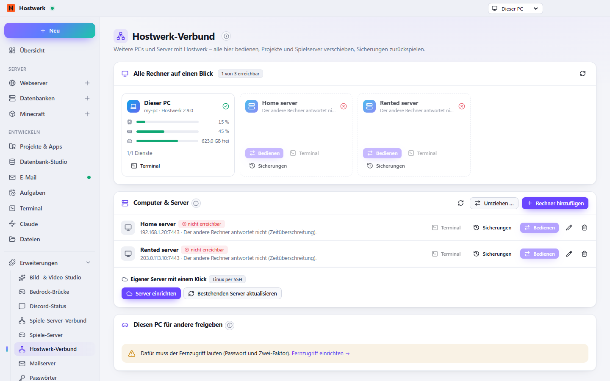

# Hostwerk-Verbund

Mehrere Rechner als ein Verbund: Laptop, Heim- und Mietserver koppeln, von hier bedienen und alle auf einen Blick sehen.

[English](README.md) · Offizielle [Hostwerk](https://github.com/Passimoritz/hostwerk-public)-Erweiterung (SDK 2.7, native Erweiterung)



## Was sie kann

- Andere Hostwerk-Installationen per Code koppeln – Zertifikat festgehalten, Schlüssel verschlüsselt gespeichert
- Die ganze Oberfläche in der Titelleiste auf einen anderen Rechner umschalten
- Alle Rechner auf einen Blick: Auslastung, Speicher, Platte, Dienste, Spieler, Probleme, letzte Sicherung – ab Hostwerk 3.0 auch ein bereites Update, die eigene letzte Sicherung des Rechners und seine Gesundheits-Punktzahl
- Eigener Server mit einem Klick: richtet Hostwerk per SSH auf einem Linux-Server ein (Node.js, Dienst, Fernzugriff mit Zwei-Faktor, Firewall, optional Domain mit Let’s Encrypt)
- Nächtliche Sicherung eines Servers auf diesen PC und Wiederherstellen einzelner Projekte, Datenbanken und Minecraft-Server
- Diesen PC für andere freigeben (widerrufbare Schlüssel)
- **Ausfall-Meldung:** Antwortet ein Rechner nicht mehr (zwei Prüfungen hintereinander, alle 2 Minuten), sagt Hostwerk Bescheid – in der Oberfläche und als Push-Nachricht aufs Handy – und wieder, wenn er zurück ist
- **Versions-Abgleich:** Rechner mit älterem oder neuerem Hostwerk sind markiert; **Hostwerk dort aktualisieren** mit einem Klick (Desktop-App – ein per SSH eingerichteter Server nimmt „Server aktualisieren“)
- **Von diesem Rechner umziehen …** direkt im Rechtsklick-Menü des Rechners (Hostwerks Umzugs-Dialog mit schon gewählter Quelle)
- Umzugspakete werden in beide Richtungen gestreamt (`rawFile`, `download`) – nichts von vielen GB liegt im Arbeitsspeicher
- Ladefehler mit *Erneut versuchen*, keine Abfragen bei verstecktem Reiter, Farben aus Hostwerks Akzent
- Andere Erweiterungen dürfen Reiter auf ihrer Seite ergänzen (`allowExtensions`)

## Installieren

In Hostwerk unter **Erweiterungen → Entdecken** auf „Installieren“ klicken. Wer die Funktion schon in Hostwerk 2.8 benutzt hat, bekommt die Erweiterung beim Update automatisch – mit allen Daten.

Native Erweiterungen laufen als Teil von Hostwerk (eigener Server- und Oberflächen-Teil). Darum installiert Hostwerk sie nur aus dem offiziellen Katalog (mit Prüfsumme) oder im Entwickler-Modus.

## Daten

`settings.machines, backups/rechner/<machine>` – genau dort, wo Hostwerk sie schon immer abgelegt hat. Entfernen der Erweiterung löscht nichts.

## Entwickeln

```bash
node --test tests/*.test.js          # Tests
node build-native.js .               # Oberfläche bauen (sdk/build-native.js aus hostwerk-public)
node check.js . --strict             # Prüfung wie im Katalog (sdk/check.js)
```

Quelltext der Oberfläche in `ui/src`, Server-Teil in `server/`. Texte im Code sind Englisch, Deutsch steht in `locales/de.json`.

## Lizenz

MIT
