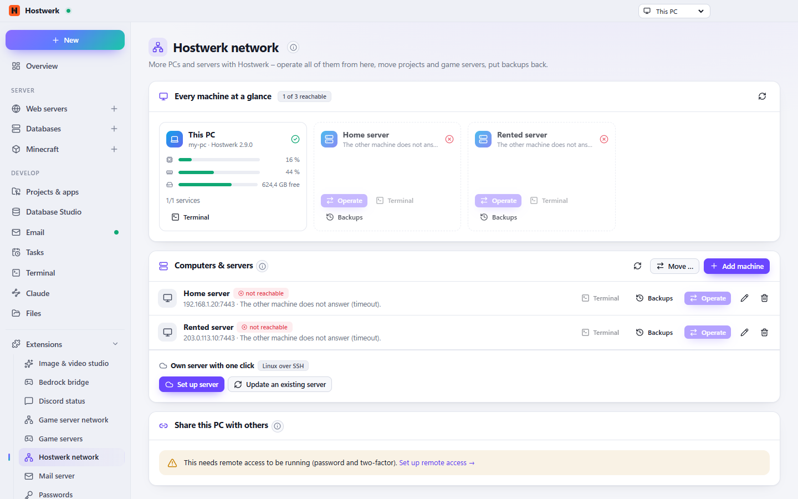

# Hostwerk network

Several machines as one network: pair laptop, home and rented servers, operate them from here and see all of them at a glance.

[Deutsch](README.de.md) · An official [Hostwerk](https://github.com/Passimoritz/hostwerk-public) extension (SDK 2.7, native extension)



## What it does

- Pair other Hostwerk installations with a code – the certificate is pinned, the key stored encrypted
- Switch the whole interface to another machine in the title bar
- Every machine at a glance: load, memory, disk, services, players, problems, last backup
- Own server with one click: sets up Hostwerk on a Linux server over SSH (Node.js, service, remote access with two-factor, firewall, optional domain with Let’s Encrypt)
- Nightly backup of a server to this PC and restore of single projects, databases and Minecraft servers
- Share this PC with others (keys you can revoke)
- **Outage alerts:** if a machine stops answering (two checks in a row, every 2 minutes), Hostwerk says so – in the interface and as a push message on the phone – and again when it is back
- **Version check:** machines with an older or newer Hostwerk are marked; **update Hostwerk there** with one click (desktop app – a server set up over SSH uses “Update server”)
- **Move from this machine …** right in the machine’s right-click menu (Hostwerk’s move dialog with the source already chosen)
- Streams move packages in both directions (`rawFile`, `download`) – nothing of many GB is held in memory
- Loading errors with *Try again*, no polling while hidden, colours from Hostwerk’s accent
- Other extensions may add tabs to its page (`allowExtensions`)

## Install

In Hostwerk: **Extensions → Discover** and click “Install”. If you already used this feature in Hostwerk 2.8, the update installs the extension by itself – with all your data.

Native extensions run as part of Hostwerk (own server and interface part). That is why Hostwerk only installs them from the official catalogue (with checksum) or in developer mode.

## Data

`settings.machines, backups/rechner/<machine>` – exactly where Hostwerk always kept it. Removing the extension deletes nothing.

## Develop

```bash
node --test tests/*.test.js          # tests
node build-native.js .               # build the interface (sdk/build-native.js from hostwerk-public)
node check.js . --strict             # same check as the catalogue (sdk/check.js)
```

Interface source in `ui/src`, server part in `server/`. Texts in the code are English, German is in `locales/de.json`.

## License

MIT
